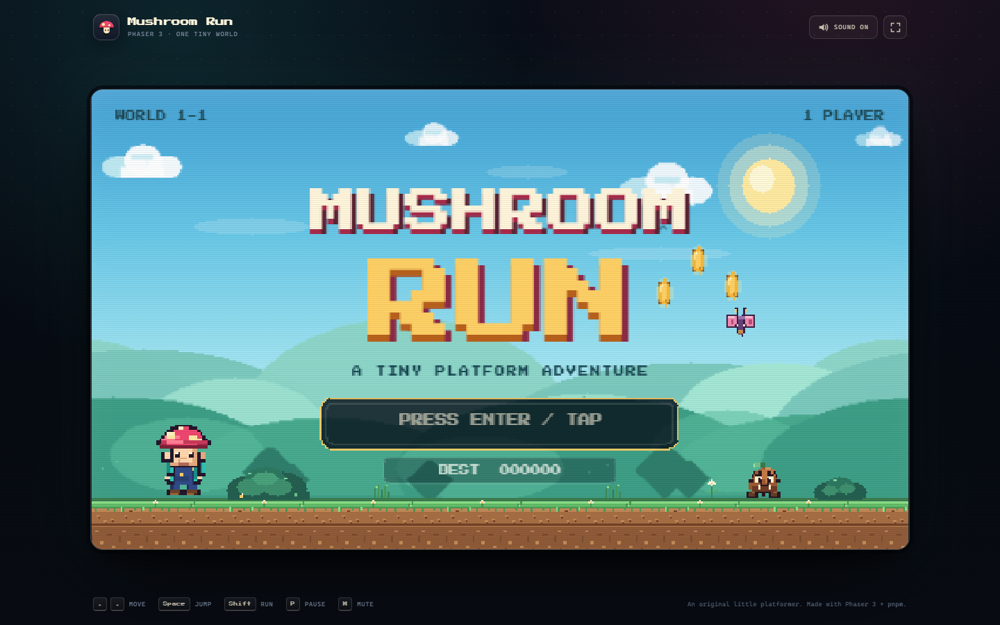
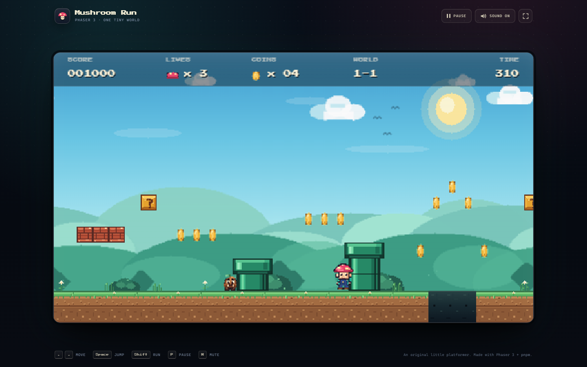
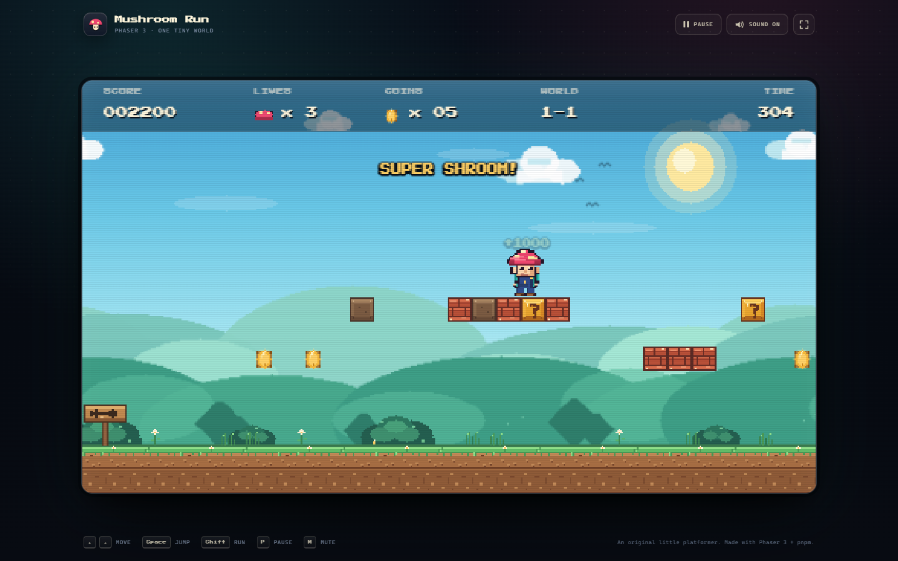
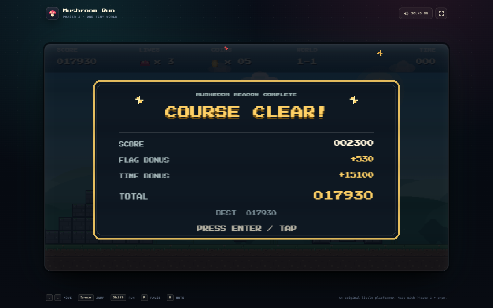
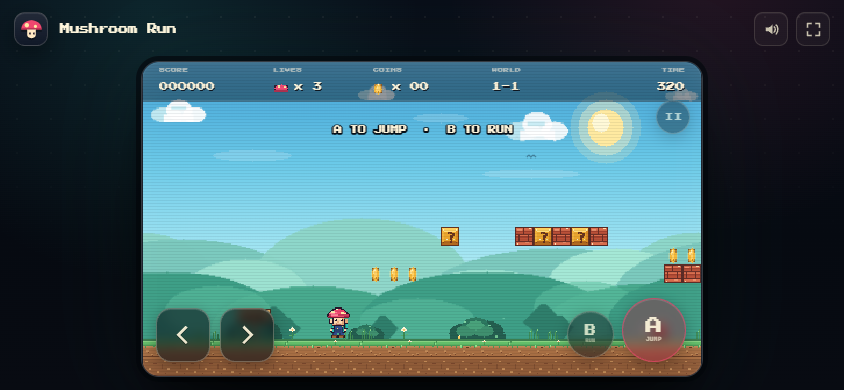

# Mushroom Run

A small, complete Mario-style platformer for the browser. It is built with **Phaser 3**, **TypeScript**, **Vite**, and **pnpm**, with original pixel art generated at runtime. No Nintendo artwork, music, or other game assets are used.



## Play

```bash
pnpm install
pnpm dev
```

Open the local URL printed by Vite (defaults to `http://127.0.0.1:5173`).

To test the production build:

```bash
pnpm build
pnpm preview
```

## Screenshots









## Controls

| Action | Keyboard | Touch |
| --- | --- | --- |
| Move | `←` / `→` or `A` / `D` | Arrow pad |
| Jump | `Space`, `↑`, or `W` | `A` button |
| Run | `Shift` | `B` button |
| Pause | `P` | Pause button or tap the pause screen |
| Mute | `M` | Speaker button |
| Fullscreen | `F` | Corner button |

## What's in the game

- A long, hand-built meadow course with gaps, pipes, brick platforms, coin trails, and a castle finish.
- Variable-height jumping with coyote time and jump buffering for responsive controls.
- Grumble enemies, flying Flutter enemies, stomp combos, and a super mushroom power-up.
- Coin blocks, breakable bricks, checkpoints, lives, a countdown clock, and a time-bonus results screen.
- Synthesized chiptune music and sound effects (Web Audio).
- Title screen, pause screen, game-over screen, victory screen, and a persisted high score.
- Responsive 16:9 presentation with a pixel-perfect canvas and touch controls.
- Original procedural pixel art: the hero, enemies, terrain, castle, and parallax backdrop are all drawn in code.

## Project layout

```text
src/
  main.ts                 Vite entry, Phaser config, web UI wiring
  style.css               The page frame and responsive/touch layout
  ui.ts                   Touch-pad state and pointer bindings
  game/
    audio.ts              Web Audio chiptune + effects
    background.ts         Parallax backdrop
    constants.ts          Shared tuning values
    textures.ts           All procedural pixel art and animations
    entities/             Player, enemy, and power-up classes
    level/                Course recipe and level builder
    scenes/               Boot, title, and gameplay scenes
```

## Notes

- Audio starts after the first click or key press, as required by browser autoplay policies.
- The `Press Start 2P` font is bundled through `@fontsource/press-start-2p` and is licensed under the SIL Open Font License.
- This is an original homage to the platformer genre, not a clone of any Nintendo course or asset.
